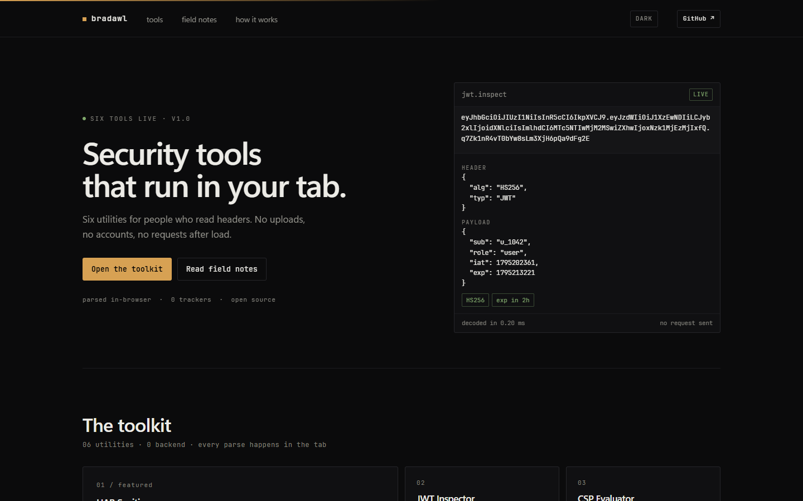
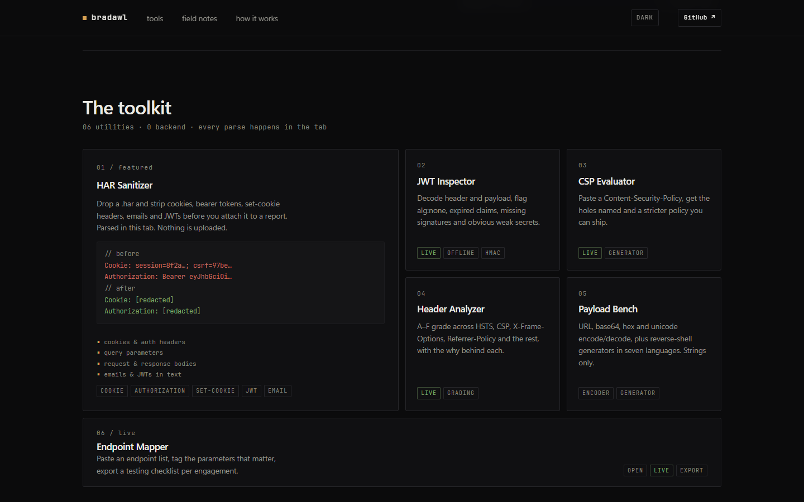
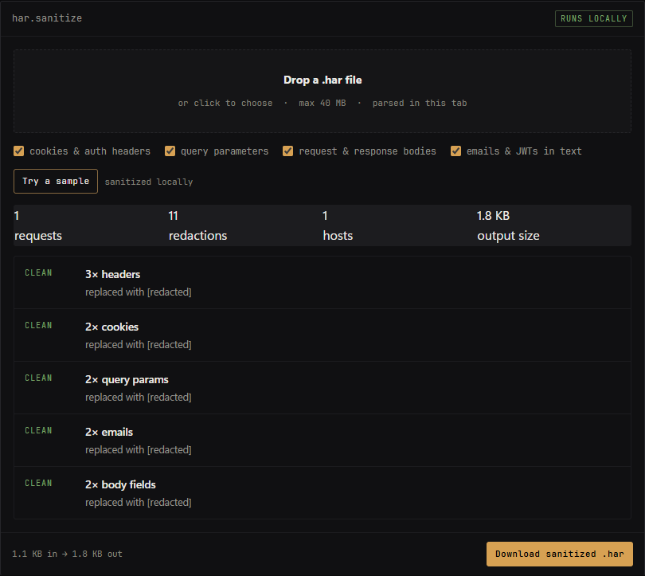
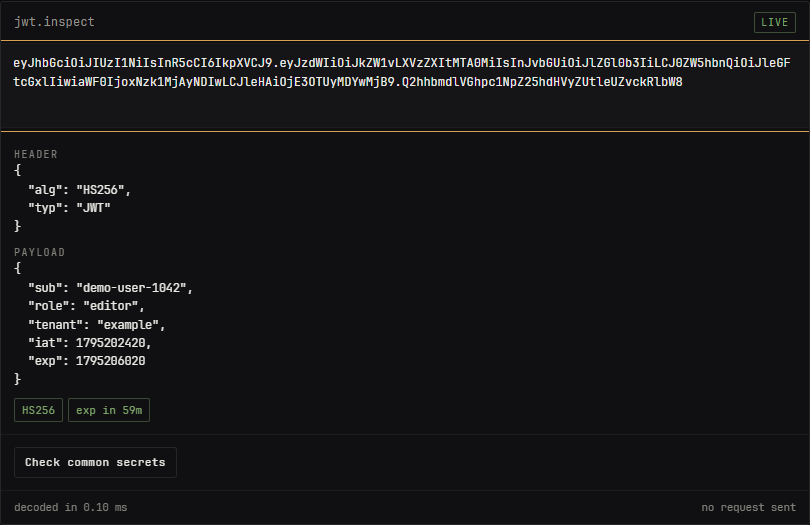
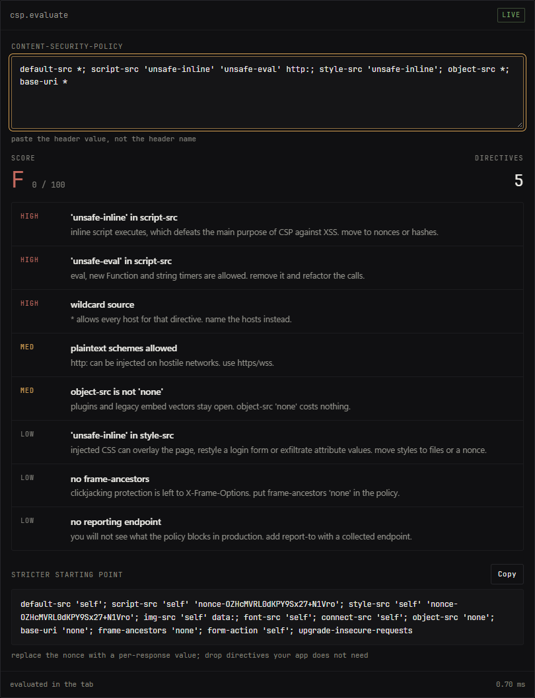
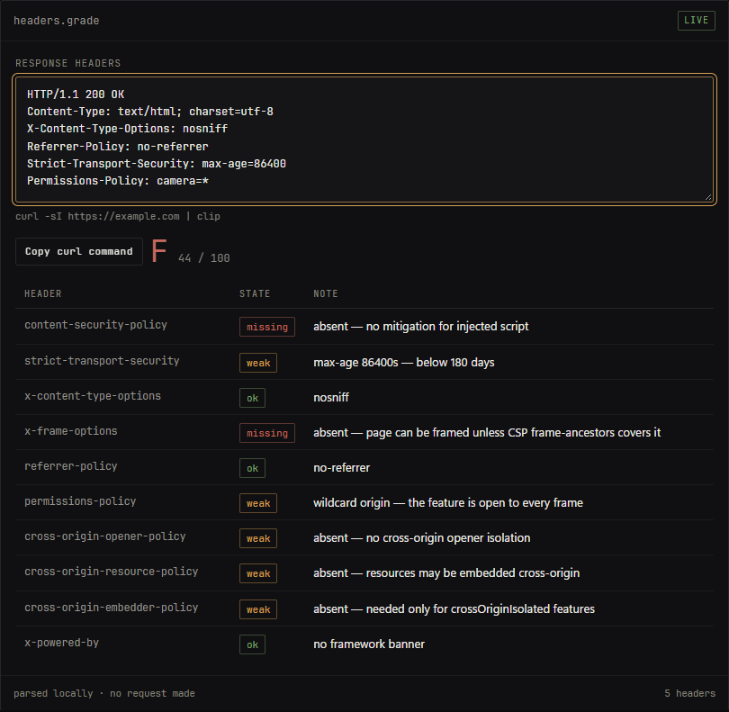
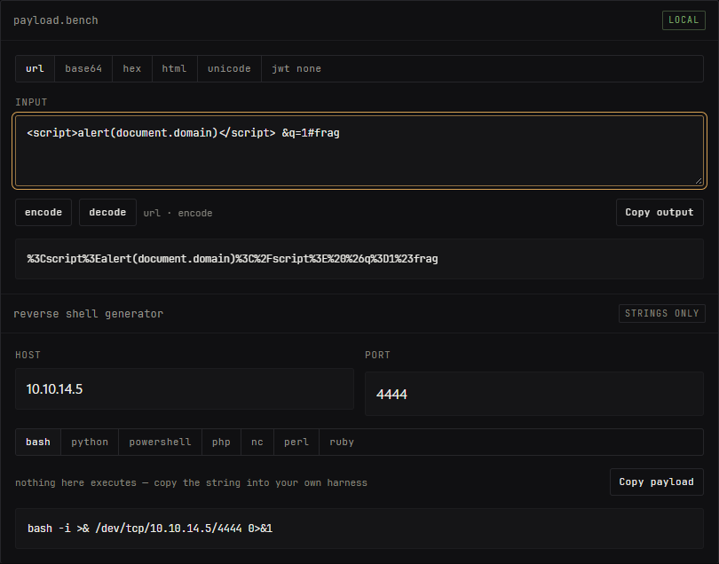
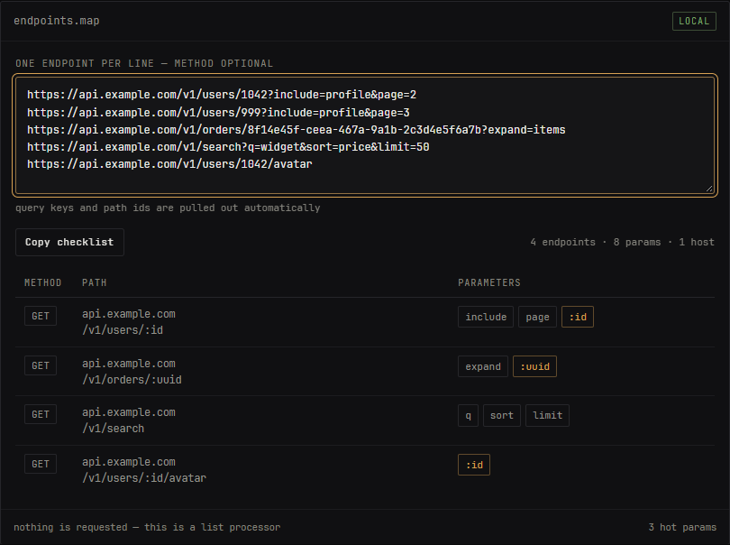
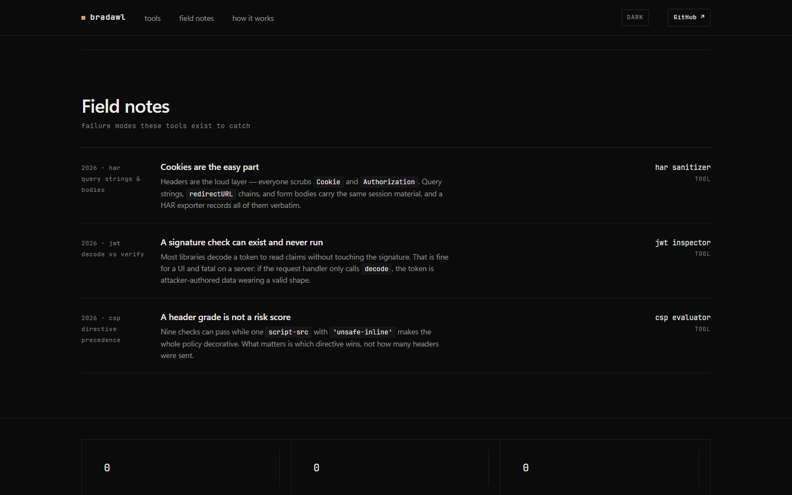

# bradawl

Six client-side security utilities, one Astro site. No backend, no accounts, no analytics — every parse happens in the visitor's tab and the build output is static HTML plus a handful of inline scripts.

## Demo

| | |
|---|---|
|  |  |
| hero with the live JWT panel running in the page | the six tools |
|  |  |
| HAR sanitizer after a sample run | JWT inspector, decoded header and payload |
|  |  |
| CSP evaluator grading a deliberately bad policy | header analyzer grading a weak response |
|  |  |
| payload bench, encoder plus reverse-shell strings | endpoint mapper pulling params out of a list |
|  | |

Every value in these screenshots is fabricated: `example.com` endpoints, a throwaway JWT, `10.10.14.5:4444`, made-up header sets. Nothing in them came from a real capture.

Regenerate with `scripts/capture.cjs` — see [Screenshots](#screenshots).

## Stack

- Astro 5 (static output, no islands)
- Vanilla TypeScript inside `<script>` tags — no React, no hydration, no client router
- Plain CSS with custom properties (`src/styles/global.css`), single amber accent, 3px radius
- Strict CSP generated at build time (`experimental.csp`): every inline script and style is hashed, no `unsafe-inline`
- Security headers in `public/_headers` for Cloudflare Pages
- Deploy target: Cloudflare Workers, assets-only (`wrangler.jsonc`)

## Layout

```
src/
  components/        one .astro file per tool, each self-contained (markup + scoped style + script)
    HarSanitizer.astro
    JwtInspector.astro
    CspEvaluator.astro
    HeaderAnalyzer.astro
    PayloadBench.astro
    EndpointMapper.astro
  data/tools.ts      slug, title, copy, notes, limits for the grid and the tool pages
  data/site.ts       brand name, canonical URL, contact email, repo URL — the only place the name lives
  layouts/Base.astro head, nav, footer, theme toggle
  pages/
    index.astro      hero + live JWT panel + tool grid + field notes
    tools/[slug].astro  one page per tool, generated from src/data/tools.ts
  styles/global.css
public/
  favicon.svg
  og.png           1200x630 link preview card
  theme-init.js    blocking theme restore, loaded before the stylesheet
  _headers         CSP frame-ancestors, HSTS, COOP/CORP/COEP, cache rules
  robots.txt
  sitemap.xml
  .well-known/security.txt
docs/screens/        README screenshots, regenerated by scripts/capture.cjs
scripts/             og.ps1, verify-deploy.ps1, capture.cjs
```

`src/pages/404.astro` builds `404.html`, served for unknown routes by the Worker's `not_found_handling` setting.

### CSP and inline scripts

Astro hashes the inline `<script>` blocks emitted from `.astro` components, but it does **not** hash `<script is:inline>`. The theme bootstrap therefore lives in `public/theme-init.js` and is referenced as `<script is:inline src="/theme-init.js">` — served from `'self'` with no hash needed, and still blocking before the first paint so there is no flash of the wrong theme. Any new inline `style="…"` attribute or unhashed inline script will be blocked by the generated CSP; use the utility classes in `global.css` instead.

## Commands

```bash
npm install
npm run dev        # http://localhost:4321
npm run check      # astro check — types + template diagnostics, must be 0/0/0
npm run og         # regenerate public/og.png (brand name lives in the card)
npm run build      # static output in dist/
npm run preview    # serve the build locally
```

`astro check` is backed by `@astrojs/check` and `typescript` (devDependencies). It is the type gate; a build can succeed with template warnings that `check` catches.

Deploy: `wrangler.jsonc` declares this as an assets-only Worker serving `dist/`, with `not_found_handling: 404-page` so unknown paths return `dist/404.html` with a 404 status. `public/_headers` is picked up from the asset directory on upload.

```bash
npm run deploy     # astro build && wrangler deploy
npm run verify:deploy -- -Domain https://<domain>   # routes, headers, cache, CSP
```

`scripts/verify-deploy.ps1` checks all seven routes, the 404 status, `security.txt`, `sitemap.xml`, `robots.txt`, `og.png`, every security header, the immutable cache rule on a hashed `/_astro` asset, and the CSP meta policy. It needs a deployed domain — half of it cannot pass locally because `astro preview` does not apply `_headers`.

`@astrojs/sitemap` is not installed on purpose — `public/sitemap.xml` is written by hand and there are only seven URLs.

## Screenshots

`scripts/capture.cjs` rebuilds `docs/screens/*.png` from a running build. Playwright is deliberately not a dependency of this repo — install it wherever you keep tooling and point `NODE_PATH` at it:

```bash
npm run build && npm run preview          # serves dist on :4321
npm i playwright && npx playwright install chromium
NODE_PATH=<where node_modules lives with playwright> node scripts/capture.cjs
```

Set `PW_CHANNEL=msedge` (or `chrome`) to drive an installed browser instead of the bundled Chromium download. `BASE_URL` overrides `http://localhost:4321`. The script forces the dark theme, jumps every reveal animation to its end state, hides the sticky header for panel-only shots, and writes nothing but PNGs into `docs/screens/`.

Every payload in the script is synthetic: `example.com` hosts, a JWT signed with a dummy secret, a made-up response-header set, `10.10.14.5:4444` for the shell generator. Do not replace them with captured traffic — the point of the set is that it can sit in a public repo.

## Tool contracts

Every tool follows the same rules:

- Zero network calls after the initial page load.
- Input stays in memory. Nothing is persisted, except the theme preference (`localStorage` key `bw-theme`).
- File input is read with `File.text()` / `arrayBuffer()` in the tab; no `fetch`, no `XMLHttpRequest`, no upload endpoint.
- Clipboard writes are wrapped in try/catch — the UI says `clipboard blocked` rather than failing silently.
- Instance-scoped selectors (`[data-har]`, `[data-jwt]`, `[data-csp]`, `[data-hdrs]`, `[data-pb]`, `[data-ep]`) so a component can appear twice on one page.

### HAR Sanitizer

`src/components/HarSanitizer.astro`. 40 MB cap. Redacts sensitive headers, cookies, query parameters, JSON body keys, emails, JWTs and Bearer tokens. Output is a downloadable `.sanitized.har` blob built in memory.

### JWT Inspector

`src/components/JwtInspector.astro`. Base64url decode, claim verdicts, optional HMAC secret check over ~60 common secrets. `compact` prop hides the secret check (used in the home hero). The secret check needs `crypto.subtle`, which requires https or localhost.

### CSP Evaluator

`src/components/CspEvaluator.astro`. Parses the header value into directives, emits weighted findings, maps to an A–F grade, generates a nonce-based strict policy.

### Header Analyzer

`src/components/HeaderAnalyzer.astro`. Ten weighted checks over a pasted response header block. Never touches the network.

### Payload Bench

`src/components/PayloadBench.astro`. Six encoders/decoders, seven reverse-shell strings, JWT `alg:none` builder. Generates text only.

### Endpoint Mapper

`src/components/EndpointMapper.astro`. Parses one URL per line, extracts query keys and numeric/UUID path segments, marks hot parameter names, exports a grouped markdown checklist.
